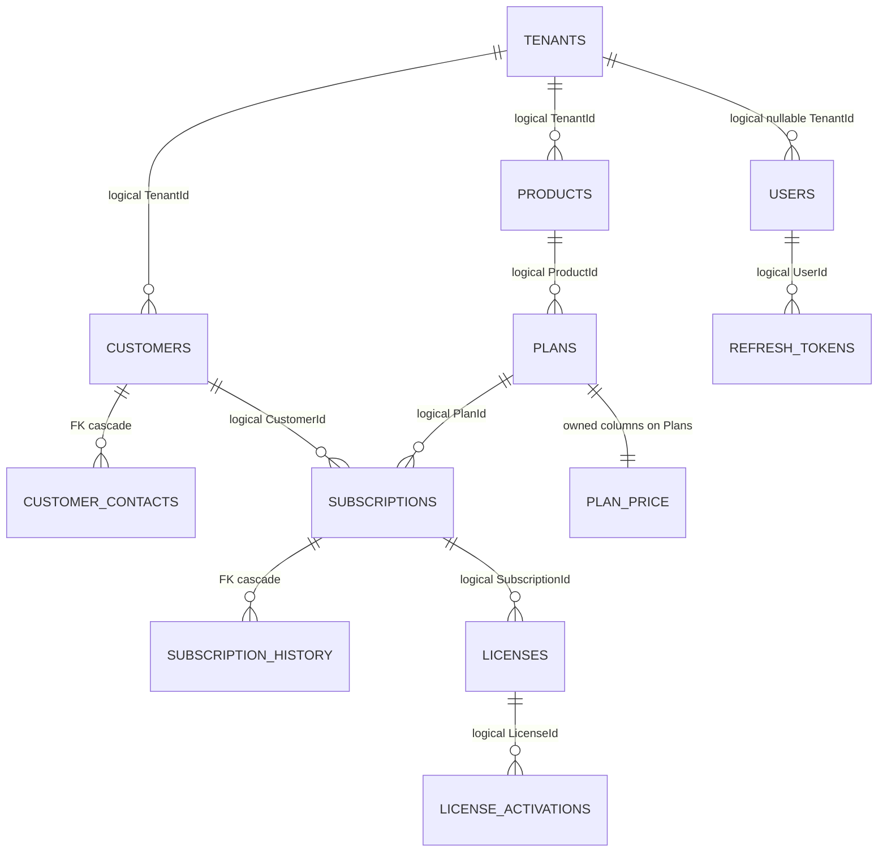

# 05 — Database

## Provider

Production: SQL Server via `Microsoft.EntityFrameworkCore.SqlServer` 10.0.9. Connection `ConnectionStrings:Default`. Migrations history table `dbo.__EFMigrationsHistory`.

Development startup (`DbInitializer`): if the provider is SQL Server and `Seed:ApplyMigrations` is true, `Database.MigrateAsync`. Non-SQL Server (tests) uses `EnsureCreatedAsync`, not migrations.

SQLite package 10.0.12 is for tests. `AppDbContext.ConfigureConventions` converts `DateTimeOffset` to binary and `decimal` to `double` only when the provider is SQLite. Do not treat SQLite numeric behavior as production behavior.

Redis is a cache, not the system of record (`Microsoft.Extensions.Caching.StackExchangeRedis` 10.0.12).

No live database was queried. Schema below is from `Configurations.cs`, `AppDbContextModelSnapshot.cs`, and migrations:

- `20261003122130_InitialCreate`
- `20261004065236_ProductPlatformsAndDeviceOs`
- `20261004090519_MediaImagesAndProductIcon`
- `20261014143626_PlanKindAndCurrentOffer`

## Schemas and tables

| Schema.Table | CLR type | Tenant filter |
|---|---|---|
| tenants.Tenants | Tenant | none (platform) |
| identity.Users | User | manual in `UserService` |
| identity.RefreshTokens | RefreshToken | none |
| customers.Customers | Customer | custom filter |
| customers.CustomerContacts | CustomerContact | custom filter |
| catalog.Products | Product | `ITenantOwned` |
| catalog.Plans | Plan | `ITenantOwned` |
| subscriptions.Subscriptions | Subscription | `ICustomerOwned` |
| subscriptions.SubscriptionHistory | SubscriptionHistory | `ITenantOwned` |
| licensing.Licenses | License | `ICustomerOwned` |
| licensing.LicenseActivations | LicenseActivation | `ICustomerOwned` |
| licensing.ActivationAttempts | ActivationAttempt | `ITenantOwned` only |
| licensing.SigningKeys | SigningKey | none (platform keys) |
| integrations.ApiClients | ApiClient | `ITenantOwned` |
| integrations.Webhooks | Webhook | `ITenantOwned` |
| audit.AuditRecords | AuditRecord | manual (`TenantId` nullable, `long` identity key) |
| reporting.UsageDaily | UsageDaily | `ICustomerOwned` |
| media.MediaFiles | MediaFile | none |
| messaging.OutboxMessages | OutboxMessage | none |
| messaging.InboxMessages | InboxMessage | none; PK `(MessageId, Handler)` |
| messaging.IdempotencyRecords | IdempotencyRecord | none; unique `(Scope, Key)` |

Ids on `Entity` subclasses are Guid v7 generated in the domain (`ValueGeneratedNever`), except `MediaFile.Create` assigns `Guid.NewGuid()`, and `AuditRecord.Id` / `IdempotencyRecord.Id` are database-generated longs.

## Enforced foreign keys

From `InitialCreate` and the model snapshot. These are the only relationships with `HasForeignKey` / `table.ForeignKey`:

1. `customers.CustomerContacts.CustomerId` → `customers.Customers.Id`, **ON DELETE CASCADE**.
2. `subscriptions.SubscriptionHistory.SubscriptionId` → `subscriptions.Subscriptions.Id`, **ON DELETE CASCADE**.
3. `catalog.Plans` owned `Money`: columns `PriceAmount`, `PriceCurrency` share the plan row (`OwnsOne`, FK to the same table's `Id`). Not a second table.

## Logical links that are not foreign keys

These Guid columns exist and are used in LINQ joins. The migrations do not add a database FK, so the database will accept orphans. **Confirmed** by absence in `Configurations.cs` and in `InitialCreate` constraints.

- Plan.ProductId → Product
- Subscription.CustomerId → Customer
- Subscription.ProductId → Product
- Subscription.PlanId → Plan
- License.SubscriptionId, CustomerId, ProductId, PlanId
- LicenseActivation.LicenseId
- ActivationAttempt.LicenseId, CustomerId (nullable)
- User.TenantId, User.CustomerId (nullable)
- RefreshToken.UserId
- ApiClient.TenantId, Webhook.TenantId
- UsageDaily.CustomerId
- MediaFile.OwnerId (polymorphic string `OwnerType`)
- Customer.ImageId, Product.ImageId, User.ImageId, Tenant.ImageId → MediaFile

## Other integrity

Unique indexes (from configurations):

- Tenant.Code
- User.Email
- RefreshToken.TokenHash
- Product (TenantId, Code)
- Plan (ProductId, Code, Version)
- License.ProductKeyHash, License.LicenseNumber
- LicenseActivation (LicenseId, DeviceId)
- ApiClient.ClientId
- SigningKey.Kid
- UsageDaily (TenantId, CustomerId, Day)
- Idempotency (Scope, Key)

No unique index enforces "one current trial plan per product" (`Plan.IsCurrent`).

Concurrency: `Subscription.Version` is a concurrency token. License slot updates use conditional `ExecuteUpdate`, not a rowversion. Other aggregates have no concurrency token.

Soft delete: none. No `IsDeleted` / `DeletedAt` on aggregates.

Audit fields: `CreatedAt` on most aggregates. No generic `UpdatedBy`. `Subscription.Version` is a counter, not a user id. Audit of who did what is `audit.AuditRecords`.

Multi-tenancy: global query filters in `AppDbContext.BuildFilter`. Platform-wide read when `IsUnrestricted && TenantId == null`. Customer scope adds `CustomerId` match for `ICustomerOwned`. `SaveChangesAsync` throws `AUTH_FORBIDDEN` / "Cross-tenant write rejected" when a non-unrestricted context writes an `ITenantOwned` row whose `TenantId` is not the scope tenant. System jobs call `TenantContext.RunAsSystem()` which sets `IsUnrestricted`.

`IgnoreQueryFilters` call sites (intentional escapes): client-credential lookup, customer name on the user profile, platform-admin user creation check, tenant dashboard counts, catalog duplicate product code, license cache invalidation by id. Each is a place a future change can leak data if the extra predicate is dropped.

## ERD (enforced vs logical)

The last group is **logical only**. Do not generate migrations that add those FKs without an explicit decision: existing rows and demo seeds were not checked for orphans, and cascade behavior would change deletes.

## Seed

`SeedOptions`: `ApplyMigrations`, `AdminEmail`, `AdminPassword`, `DemoData`.

Bootstrap creates a platform admin only when none exists (`DbInitializer.BootstrapAdminAsync`).

Demo data (`DemoAccounts`) runs when `DemoData` is true. Known keys and client secrets are constants in that file and repeated in `README.md`. `appsettings.Development.json` currently has `DemoData: false`.
